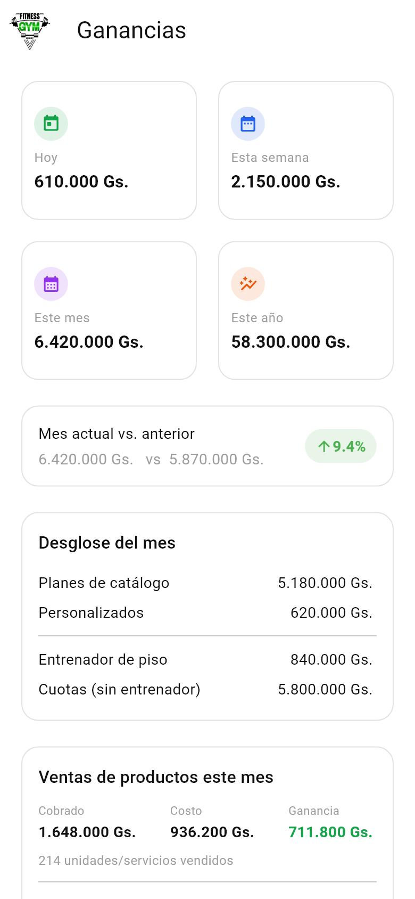
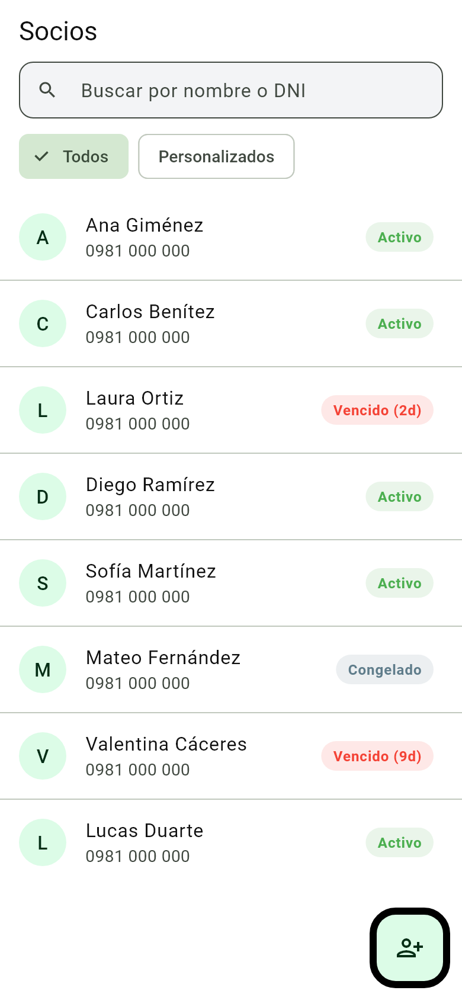
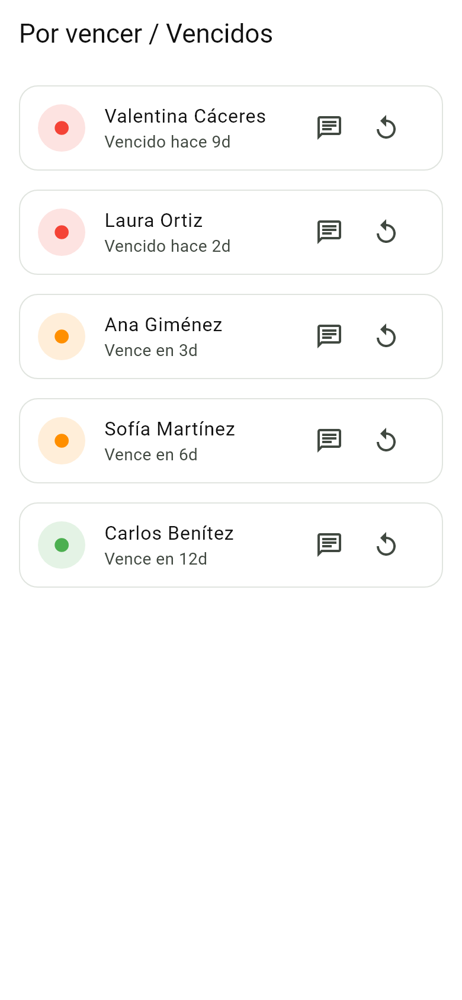
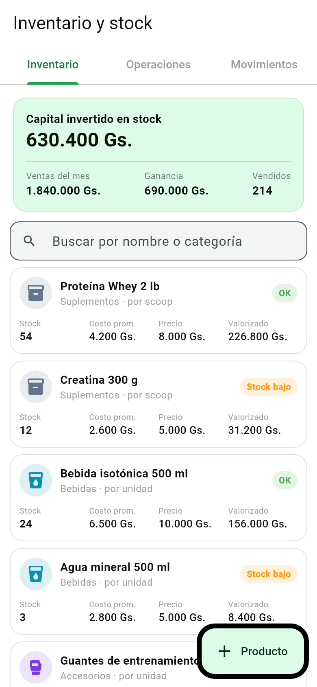

# CarapeguaGym

**Sistema de gestión para gimnasios** — aplicación móvil que administra socios, membresías, cobros diarios, inventario de productos y reportes financieros, con backend en Supabase (PostgreSQL).


---

## Capturas

<table>
  <tr>
    <td align="center"><br><b>Ganancias</b><br>Hoy, semana, mes, año y desglose</td>
    <td align="center"><br><b>Socios</b><br>Estado de cada membresía</td>
    <td align="center"><br><b>Por vencer / vencidos</b><br>Aviso y renovación en un toque</td>
    <td align="center"><br><b>Inventario</b><br>Capital invertido, stock y costo promedio</td>
  </tr>
</table>

> Las capturas usan **datos de ejemplo**. Se generan solas con
> `CAPTURAS_DIR=docs/capturas flutter test test/capturas_readme_test.dart`.

---

## Descripción

Aplicación desarrollada para la administración diaria de un gimnasio real. Reemplaza el registro manual de socios y cobros por un sistema centralizado que calcula automáticamente vencimientos, ingresos, stock y ganancias.

El foco del proyecto fue que **alguien sin experiencia técnica pueda usarlo sin cometer errores**: cada formulario valida los datos, explica en lenguaje simple qué está mal y pide confirmación antes de cualquier operación que mueva dinero o stock.

## Funcionalidades

### Socios y membresías
- Alta, edición y baja lógica de socios (el historial de pagos se conserva).
- Solo nombre y apellido obligatorios; cédula, teléfono, email, IMEI y foto opcionales, con validación de formato y detección de cédula duplicada.
- Catálogo de paquetes de membresía con precio fijo.
- Cobro por cantidad de meses (1 a 12): el total y la fecha de vencimiento se calculan solos.
- Adicional de entrenador de piso y filtro de socios con plan personalizado.
- Estado de cada socio (activo, vencido, congelado) y lista de vencimientos próximos.
- Contacto directo por WhatsApp (normaliza números locales al formato internacional).

### Cobros del día
- **Pase del día** con precio configurable y reutilizable, cobrado con un toque.
- **Venta rápida de productos** desde la misma pantalla.
- Cliente opcional: se puede enlazar un socio existente, registrar uno nuevo o cobrar sin datos.
- **Caja del día**: total diario de cuotas, pases y ventas, con navegación por fechas y filtro por método de pago.
- Anulación de cobros con confirmación y reversión completa.

### Inventario
- Productos que se venden **por porción** (scoops de proteína, con opción de vender el pote entero) o **por unidad** (bebidas, accesorios).
- Compras por pack con cálculo automático del costo unitario.
- **Costo promedio ponderado** recalculado en cada compra.
- Carga de potes ya abiertos indicando el remanente real.
- Vencimientos, alertas de stock bajo y categorías personalizadas.
- Historial de movimientos (compras, ventas, bajas) con stock y costo antes/después.
- Capital invertido en stock y ganancia por producto.

### Reportes y panel
- Panel de ingresos: hoy, semana, mes y año, comparación mensual y evolución de 12 meses.
- Ganancia por venta de productos y ranking de los más rentables.
- Tasa de renovación y ranking de pagos tardíos.
- Exportación de reportes a **PDF** y **Excel**.

### Seguridad y experiencia
- Inicio de sesión con email y contraseña y **desbloqueo biométrico** (huella / rostro).
- Notificaciones locales de vencimientos y resúmenes diarios y semanales.
- Pantallas de política de privacidad y términos y condiciones.

## Aspectos técnicos destacados

| Desafío | Solución |
|---|---|
| **Consistencia del inventario** con operaciones concurrentes | Toda la lógica de stock vive en una función PL/pgSQL (`record_stock_movement`) que bloquea la fila del producto (`SELECT … FOR UPDATE`) y recalcula stock, costo ponderado y vencimiento en una sola transacción. |
| **Cobros duplicados** cuando la red falla después de que el servidor ya guardó | **Idempotencia**: cada operación envía una clave única (`op_id`, UUID v4) con índice `UNIQUE`; si se reintenta, la base devuelve el registro existente en lugar de duplicarlo. |
| **Anular operaciones** sin corromper el costo promedio | `void_stock_movement` revierte el stock y, para compras, restaura el costo previo solo si es el movimiento más reciente, lo que garantiza una reversión exacta. |
| **Aislamiento de datos** | Row Level Security (RLS) activo en todas las tablas; solo usuarios autenticados pueden leer o escribir. |
| **Inyección en filtros** de búsqueda | Sanitización de términos antes de construir filtros `or()` de PostgREST. |
| **Errores comprensibles** | Capa que traduce excepciones de red, autenticación y PostgreSQL (`23505`, `42501`, etc.) a mensajes en lenguaje simple, sin exponer detalles internos. |
| **Fechas y montos** | Suma de meses sin desbordes (31/01 + 1 mes = 28/02), formato de guaraníes y límites contra montos gigantes o con ceros de más. |
| **Bloqueo biométrico** | Si no se puede leer la preferencia de seguridad, la app pide identidad igual (*fail-closed*). |

## Stack tecnológico

| Capa | Tecnología |
|---|---|
| Frontend | Flutter · Dart · Material 3 |
| Estado | Riverpod |
| Backend | Supabase (PostgreSQL, Auth, Storage) |
| Lógica en base de datos | PL/pgSQL (funciones transaccionales), RLS |
| Seguridad local | `local_auth` (biometría), `flutter_secure_storage` |
| Notificaciones | `flutter_local_notifications` |
| Reportes | `pdf`, `printing`, `excel`, `fl_chart` |
| Pruebas | `flutter_test` (unitarias y de widgets) |

## Arquitectura

Organización por capas (datos, lógica y presentación) y por funcionalidad:

```
lib/
├── core/            # Tema, cliente Supabase, validadores, formateo y manejo de errores
├── data/
│   ├── models/      # Entidades inmutables con serialización JSON
│   └── repositories/# Acceso a datos (Supabase) aislado de la UI
├── providers/       # Inyección de dependencias con Riverpod
└── features/        # Un módulo por funcionalidad
    ├── auth/        # Login, bloqueo biométrico
    ├── members/     # Socios
    ├── charge/      # Mensualidades, pase del día, caja
    ├── memberships/ # Venta por paquete
    ├── stock/       # Inventario, compras, ventas, movimientos
    ├── dashboard/   # Panel de ingresos
    ├── reports/     # Reportes y exportación
    └── ...
supabase/            # Scripts SQL
test/                # Pruebas unitarias y de widgets
```

Los repositorios se inyectan mediante providers, lo que permite reemplazarlos por implementaciones falsas en las pruebas sin depender de la red.

### Modelo de datos

- `members`, `plans`, `membership_periods`: socios, paquetes y períodos pagados.
- `daily_passes`: pases del día, con vínculo opcional a un socio.
- `stock_products`, `stock_movements`: inventario con costo ponderado y registro de cada movimiento.
- `app_settings`: configuración compartida (avisos, precio del pase del día).
- Vistas para estado de socios, renovaciones y pagos tardíos.

## Pruebas

El proyecto incluye **71 pruebas automatizadas**:

- **Unitarias**: validadores, cálculo de costo ponderado, montos por mes, generación de claves de idempotencia, traducción de errores y cálculos del panel.
- **De widgets (flujos de usuario)**: simulan a una persona cargando datos incorrectos y verifican que la app explique el error y no guarde nada inválido (formulario de socios, cobro de mensualidades, pase del día, filtros).

```bash
flutter test
flutter analyze
```

## Instalación y configuración

**Requisitos:** Flutter 3.x, un proyecto de [Supabase](https://supabase.com) y Android SDK para compilar el APK.

```bash
# 1. Clonar
git clone https://github.com/GabrielLeon1111/CarapeguaGym.git
cd CarapeguaGym

# 2. Configurar las credenciales de Supabase
cp lib/core/supabase/env.example.dart lib/core/supabase/env.dart
#    y completar supabaseUrl y supabasePublishableKey

# 3. Instalar dependencias y ejecutar
flutter pub get
flutter run

# 4. Generar el APK
flutter build apk --release
```

> Las credenciales viven en `env.dart`, que está excluido de Git. Nunca se suben al repositorio.

## Próximos pasos

- Extender la idempotencia a los cobros de mensualidades y pases del día.
- Módulo de rutinas para socios con entrenador de piso.
- Soporte multi-dispositivo con roles (administrador y recepción).
- Versión para iOS.

## Autor

**Gabriel León** — [@GabrielLeon1111](https://github.com/GabrielLeon1111)
